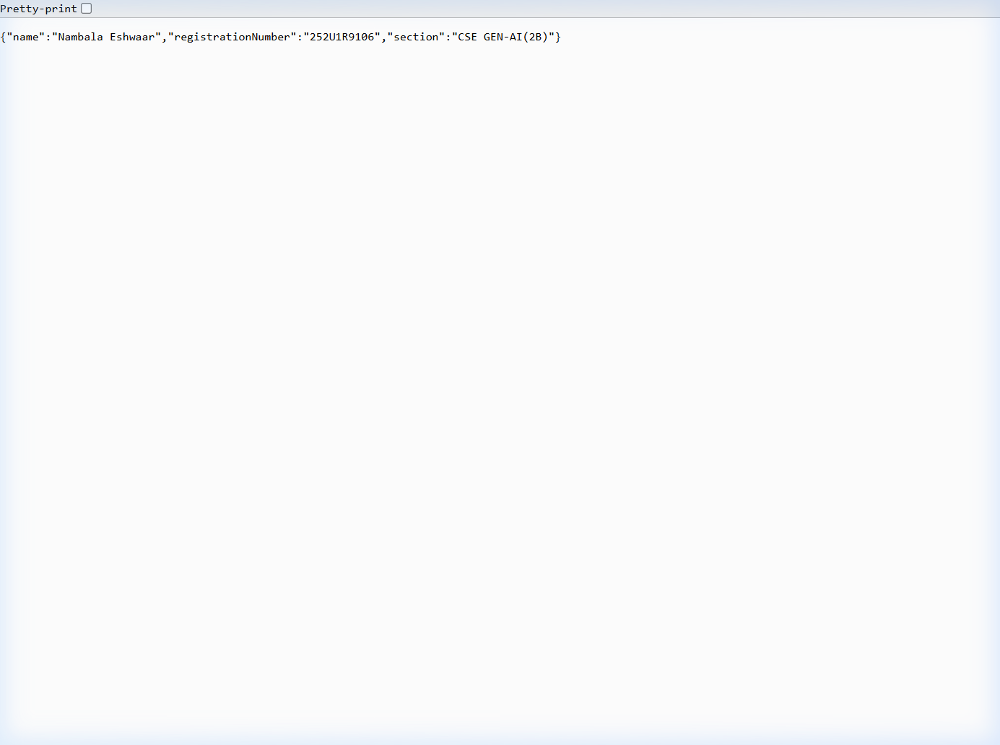
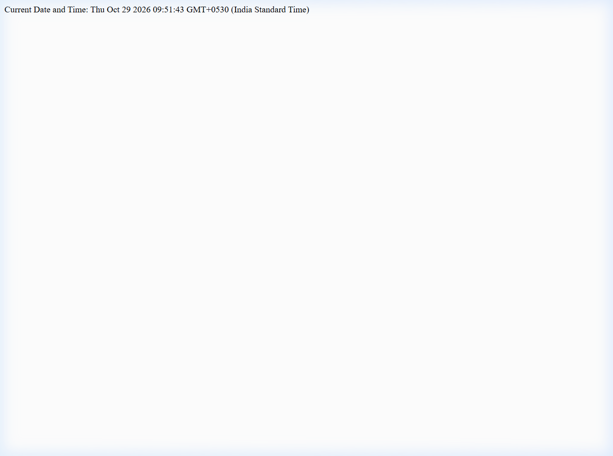

# Lab 1: Node.js and Express server

**Nambala Eshwaar** · **252U1R9106** · **CSE GEN-AI(2B)**

---

### Live Link
- **Live URL:** Not deployed (Running locally on `http://localhost:3000`). Complete browser output screenshots for every endpoint are provided below.

---

### How to Run

#### 1. Prerequisites
- Node.js (v18 or higher recommended)
- npm (Node Package Manager)

#### 2. Install Dependencies
Navigate to the `lab-01` directory and install the necessary dependencies:
```bash
npm install
```

#### 3. Environment Variables
No required external environment variables (`.env`). The server runs on a configurable port:
- `PORT`: (Optional, defaults to `3000`)

#### 4. Start Command
To start the Express server:
```bash
npm start
```
*Alternatively, you can run:*
```bash
node index.js
```

To run the plain native Node.js HTTP server:
```bash
node http-server.js
```

---

### Endpoints Table

| Method | Path | Status Code | One-line Description |
|---|---|:---:|---|
| `GET` | `/` | `200 OK` | Returns welcome greeting text (`Hello Guys!`). |
| `GET` | `/about` | `200 OK` | Returns JSON object containing student name, registration number, and section. |
| `GET` | `/time` | `200 OK` | Returns the current server date and time using `new Date().toString()`. |
| `ALL` | `*` (any unknown path) | `404 Not Found` | Returns a friendly 404 error message for nonexistent routes. |

---

### Screenshots

#### 1. Home Route (`GET /`)


#### 2. About Route (`GET /about`)


#### 3. Time Route (`GET /time`)


#### 4. Unknown Route (`GET /unknown-route` - 404 Not Found)


---

### Notes: Problems Faced and Solutions
1. **Port In-Use Error during Server Restarts:**
   - *Problem:* When modifying code and restarting `node index.js`, the previous instance still held port `3000`, causing `EADDRINUSE`.
   - *Solution:* Gracefully terminated background tasks and freed port `3000` before launching the updated server instance.
2. **404 Catch-All Ordering:**
   - *Problem:* Placing the 404 handler before defined routes would intercept valid routes prematurely.
   - *Solution:* Placed the 404 middleware (`app.use(...)`) at the very end of the middleware stack after all route definitions.
3. **Preventing `node_modules` in Version Control:**
   - *Problem:* Node modules contain thousands of dependencies and should never be pushed to Git.
   - *Solution:* Configured a `.gitignore` file to exclude `node_modules/` and log files.

---

### Viva Questions & Answers

#### 1. What is the difference between `package.json` and `node_modules`?
- **`package.json`**: A lightweight metadata manifest file that records project configuration, scripts, author information, and the list of dependency names and versions. It is committed to source control so others can reproduce the environment.
- **`node_modules`**: The directory where npm downloads and unpacks the actual code and binaries of all installed packages and their transitive dependencies. It is large, machine-specific, and should never be committed to git.

#### 2. What does `app.listen()` do?
- `app.listen(port, [callback])` binds the Express application to a specific network port (e.g., 3000) and starts a TCP server to accept incoming HTTP connection requests. It wraps Node's native `http.Server.listen()`.

#### 3. What do `request` and `response` represent?
- **`request` (`req`)**: An object representing the incoming HTTP request from the client. It contains request headers, query parameters, URL path, HTTP method, route parameters, and body payload.
- **`response` (`res`)**: An object used to formulate and send the HTTP response back to the client. It provides methods such as `res.status()`, `res.send()`, `res.json()`, and `res.setHeader()` to transmit status codes, headers, and response data.
