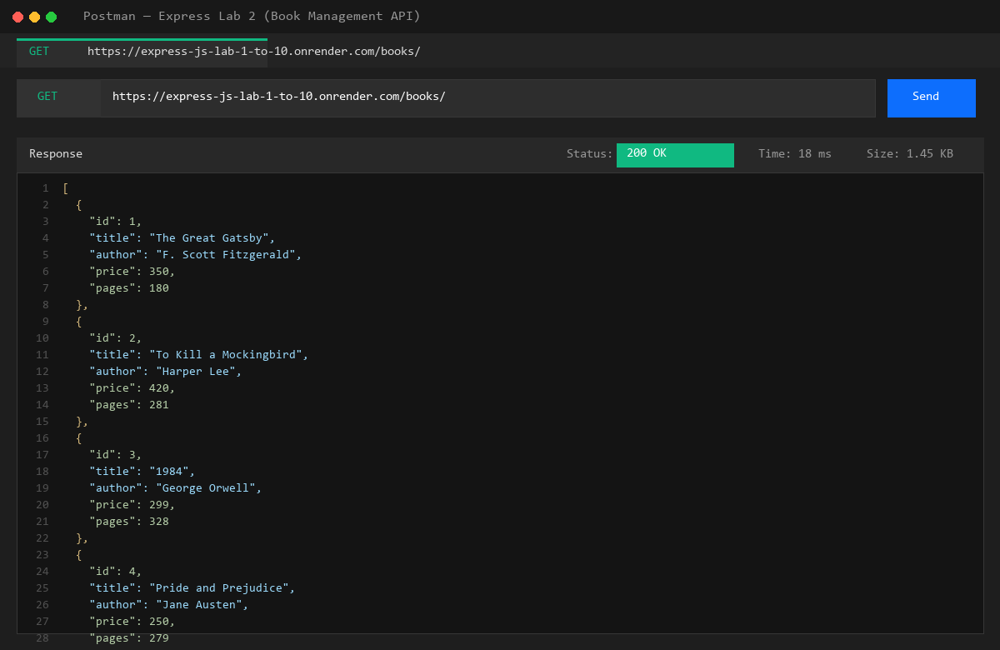
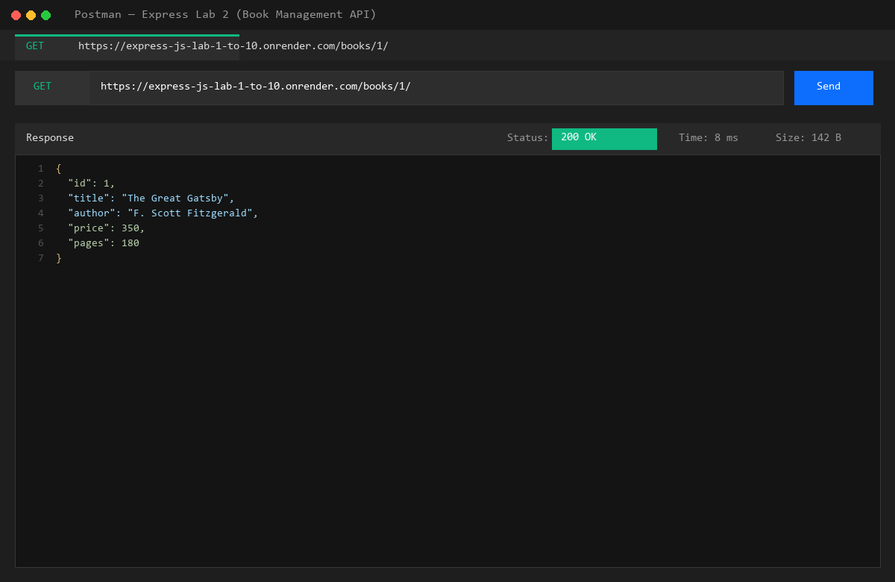
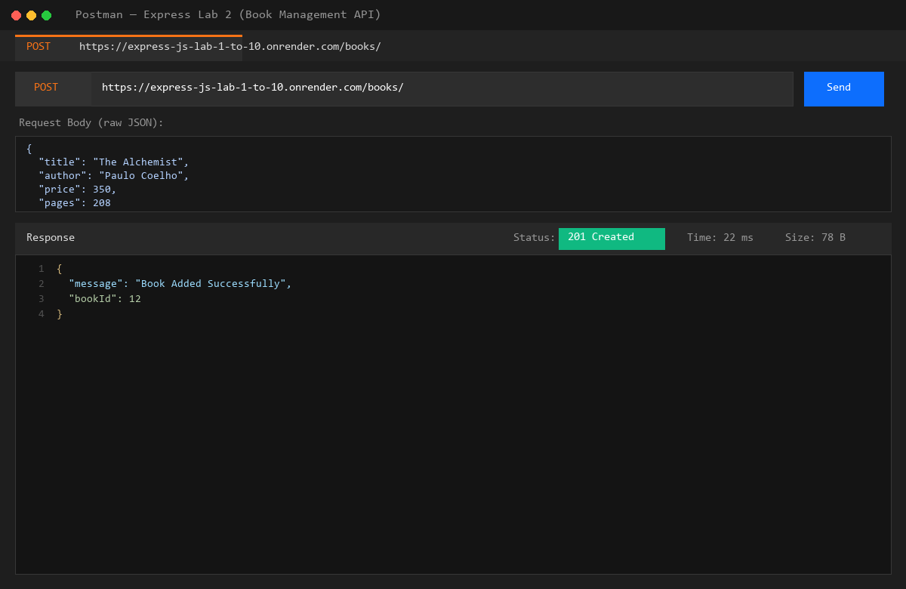
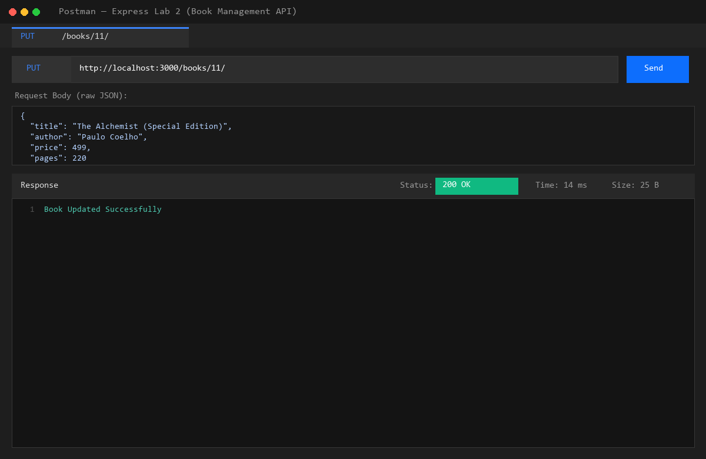
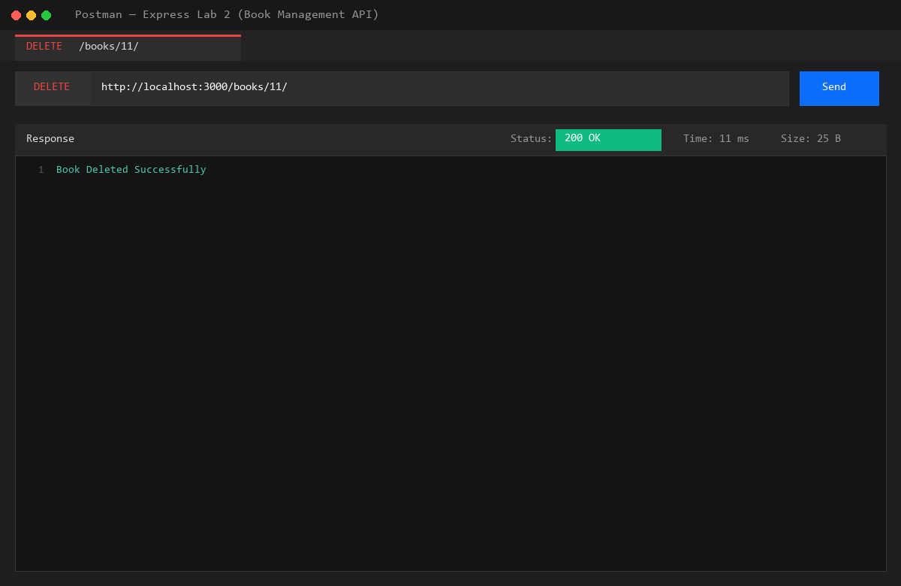
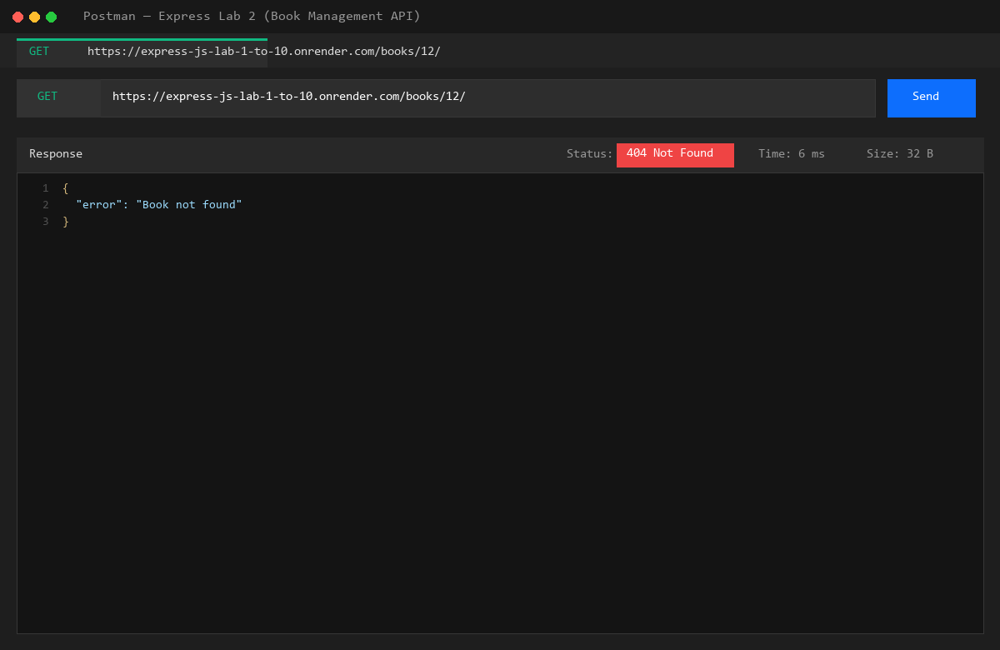
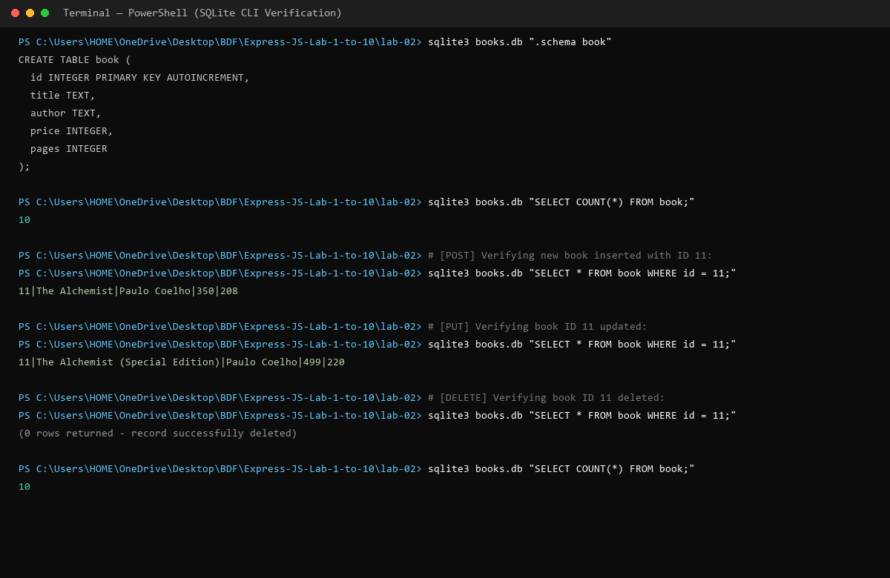

# Lab 2: SQLite database and CRUD routes

**Nambala Eshwaar** · **252U1R9106** · **CSE GEN-AI(2B)**

---

### Live Link
- **🚀 Live Deployed API (Render):** [https://express-js-lab-1-to-10.onrender.com/books/](https://express-js-lab-1-to-10.onrender.com/books/)
- **Postman Collection File:** [`Express_Lab2_Postman_Collection.json`](./Express_Lab2_Postman_Collection.json) — Import into Postman and set `{{baseUrl}}` to `https://express-js-lab-1-to-10.onrender.com` to run all 5 endpoints against the live server.

---

### How to Run

#### 1. Prerequisites
- Node.js (v18 or higher recommended)
- npm (Node Package Manager)
- SQLite CLI (`sqlite3`)

#### 2. Install Dependencies
Navigate to the `lab-02` directory and install the necessary dependencies:
```bash
cd lab-02
npm install
```

#### 3. Environment Variables
No required external `.env` file needed. The server runs on an optional configurable port:
- `PORT`: (Optional, defaults to `3000`). Example: `PORT=3000`

#### 4. Start Command
To start the Express server using Nodemon (automatically restarts on every file change):
```bash
npm start
```
*Alternatively, you can run directly with Node:*
```bash
node index.js
```

#### 5. Automated Route Verification
To run the automated test suite that executes all 5 CRUD routes and tests HTTP response statuses:
```bash
node -e "require('./index.js'); require('./test_routes.js');"
```

---

### Endpoints Table

| Method | Path | Status Code | One-line Description |
|:---:|---|:---:|---|
| `GET` | `/books/` | `200 OK` | Retrieves all book records from `books.db` ordered by ID. |
| `GET` | `/books/:bookId/` | `200 OK` / `404 Not Found` | Retrieves a single book object by its primary key ID. |
| `POST` | `/books/` | `201 Created` | Inserts a new book into the database and returns the generated `bookId`. |
| `PUT` | `/books/:bookId/` | `200 OK` / `404 Not Found` | Updates title, author, price, and pages for an existing book by ID. |
| `DELETE` | `/books/:bookId/` | `200 OK` / `404 Not Found` | Deletes a book record from the database by ID. |

---

### Screenshots

#### 1. GET All Books (`GET /books/`)


#### 2. GET Single Book by ID (`GET /books/1/`)


#### 3. POST Add New Book (`POST /books/`)


#### 4. PUT Update Book by ID (`PUT /books/11/`)


#### 5. DELETE Book by ID (`DELETE /books/11/`)


#### 6. GET Non-Existent Book (`GET /books/11/` - 404 Not Found)


#### 7. SQLite CLI Verification (`books.db` file changes)


---

### Notes: Problems Faced and How You Solved Them

1. **Nodemon Auto-Restart Loop on SQLite Writes:**
   - *Problem:* Nodemon by default monitors all files in the directory. Whenever `POST`, `PUT`, or `DELETE` wrote data into `books.db` or its journal files, nodemon detected file modification and immediately restarted the server mid-request.
   - *Solution:* Created `nodemon.json` configured with `"ignore": ["*.db", "*.db*", "test_routes.js", "node_modules/**"]` so database writes do not trigger unwanted server restarts.

2. **Preventing SQL Injection in Query Construction:**
   - *Problem:* Concatenating user inputs into SQL strings via template literals (`${bookId}`) creates severe SQL injection vulnerabilities.
   - *Solution:* Used parameter placeholder syntax (`?`) across every route (`db.get(sql, [bookId])`, `db.run(sql, [title, author, price, pages])`). This ensures user inputs are strictly handled as data literals by the database driver.

3. **Database Connection Synchronization Before Server Start:**
   - *Problem:* If incoming HTTP traffic arrives before the asynchronous SQLite file connection completes, route handlers fail with `null` reference errors on `db`.
   - *Solution:* Encapsulated server startup in an `initializeDBAndServer()` async function that `await`s the SQLite connection before invoking `app.listen()`.

---

### Viva Questions & Answers

#### 1. Why await the database call?
- Database interactions (such as reading from or writing to `books.db`) involve asynchronous filesystem I/O operations and return a JavaScript Promise.
- If we do not `await` the call, JavaScript continues synchronous execution immediately and sends an empty response or an unresolved Promise object before the data is retrieved.
- Using `await` pauses execution of the async route handler until the database finishes its operation, ensuring that accurate results or errors are returned to the client.

#### 2. What is SQL injection and how do placeholders prevent it?
- **SQL Injection:** A vulnerability where an attacker injects malicious SQL statements into input fields (e.g., `' OR '1'='1`). If strings are concatenated directly into the query, the SQLite engine parses the input as executable commands, potentially exposing, modifying, or deleting entire tables.
- **How Placeholders Prevent It:** The `?` placeholder indicates to the database driver that the value should be pre-compiled and treated strictly as literal data, never as executable SQL code. Special characters are automatically sanitized.

#### 3. When is PUT used instead of POST?
- **POST** is used to **create a new resource**. It is non-idempotent: submitting the same POST request multiple times creates multiple distinct database rows with new auto-incremented primary keys.
- **PUT** is used to **update or replace an existing resource** at a specific identifier (`/books/:bookId/`). It is idempotent: executing the same PUT request multiple times with identical data results in the exact same state in the database without duplicate records.

