# Lab 3: REST API, query parameters, validation, debugging

**Nambala Eshwaar** · **252U1R9106** · **CSE GEN-AI(2B)**

---

### Live Link
- **🌐 Live Deployed API (Render):** [https://express-js-lab-1-to-10.onrender.com/books/](https://express-js-lab-1-to-10.onrender.com/books/)
- **📬 Postman Collection File:** [`Express_Lab3_Postman_Collection.json`](./Express_Lab3_Postman_Collection.json) — Import into Postman and set `{{baseUrl}}` to `https://express-js-lab-1-to-10.onrender.com` or `http://localhost:3000` to test all success and failure cases.

---

### How to Run

#### 1. Prerequisites
- Node.js (v18.x or v20.x+ recommended)
- npm (Node Package Manager)
- SQLite3 CLI (optional)

#### 2. Install Dependencies
Navigate into the `lab-03` directory and install the required packages:
```bash
cd lab-03
npm install
```

#### 3. Environment Variables
No sensitive secrets or `.env` files are required. The server accepts optional standard configuration variables:
- `PORT`: (Optional, defaults to `3000`). Example: `PORT=3000`
- `NODE_ENV`: (Optional, defaults to `development`). Example: `NODE_ENV=production`

#### 4. Database Initialization
Seed the SQLite database with 10 classic books:
```bash
node setup_db.js
```

#### 5. Start Command
To start the development server with Nodemon (auto-restarts on code edits):
```bash
npm start
```
*Alternatively, run directly with Node:*
```bash
node index.js
```

#### 6. Automated Route Verification
To run the automated test suite testing all 14 CRUD, search, filter, pagination, and validation cases:
```bash
node -e "require('./index.js'); require('./test_routes.js');"
```

#### 7. Debugging Exercise Runner
To execute the automated diagnostic runner proving all 4 faculty bug fixes:
```bash
node debugging_exercise/test_debugging.js
```

---

### Endpoints Table

| Method | Path | Status Code | One-line Description |
|:---:|---|:---:|---|
| `GET` | `/books` | `200 OK` / `400 Bad Request` | Retrieves books with support for search (`search_q`), sorting (`order_by`, `order`), price range (`min_price`, `max_price`), and pagination (`limit`, `offset`). |
| `GET` | `/books/:bookId` | `200 OK` / `404 Not Found` | Retrieves a single book object by its integer primary key ID. |
| `POST` | `/books` | `201 Created` / `400 Bad Request` | Validates body and creates a new book, returning generated `bookId`. |
| `PUT` | `/books/:bookId` | `200 OK` / `400 Bad Request` / `404 Not Found` | Validates body and updates title, author, price, and pages for an existing book by ID. |
| `DELETE` | `/books/:bookId` | `200 OK` / `404 Not Found` | Deletes a book record from the database by ID. |

---

### Query Parameters Reference (`GET /books`)

| Parameter | Type | Default | Description |
|---|:---:|:---:|---|
| `search_q` | String | `""` | Partial title match using SQL `LIKE ?` (`%search_q%`). |
| `order_by` | String | `"id"` | Column to sort by: `id`, `title`, `author`, `price`, `pages`. Whitelisted against SQL injection. |
| `order` | String | `"ASC"` | Sort direction: `ASC` or `DESC` (case-insensitive). |
| `limit` | Integer | `10` | Maximum number of book records per page. |
| `offset` | Integer | `0` | Number of book records to skip. |
| `min_price` | Number | None | Minimum price filter (`price >= min_price`). Uses `BETWEEN` when paired with `max_price`. |
| `max_price` | Number | None | Maximum price filter (`price <= max_price`). Uses `BETWEEN` when paired with `min_price`. |

---

### Screenshots

#### 1. GET All Books with Default Parameters (`GET /books`)
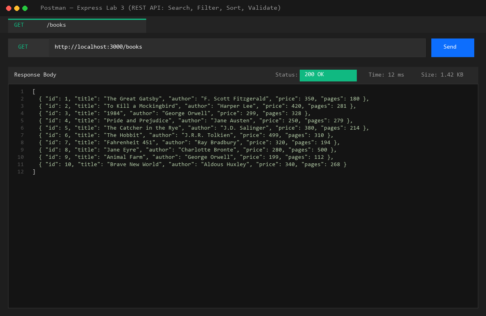

#### 2. Search Books by Title with LIKE (`GET /books?search_q=Gatsby`)
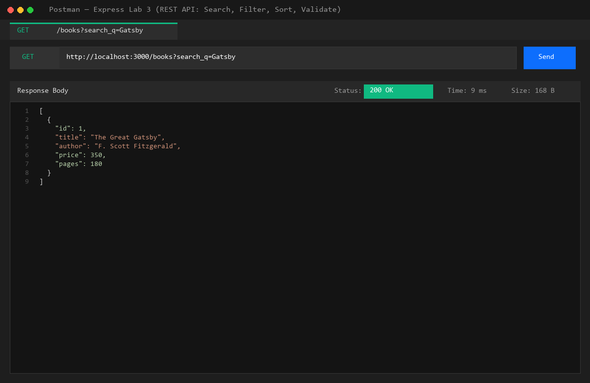

#### 3. Sorting by Price Descending (`GET /books?order_by=price&order=DESC&limit=4`)
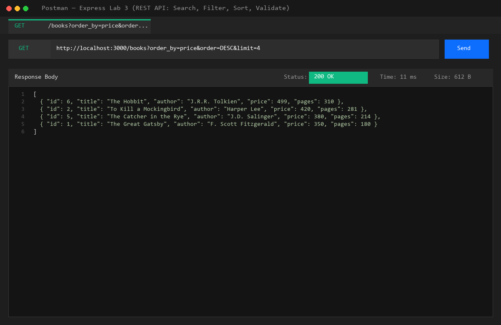

#### 4. Price-Range Filter (`GET /books?min_price=250&max_price=350`)
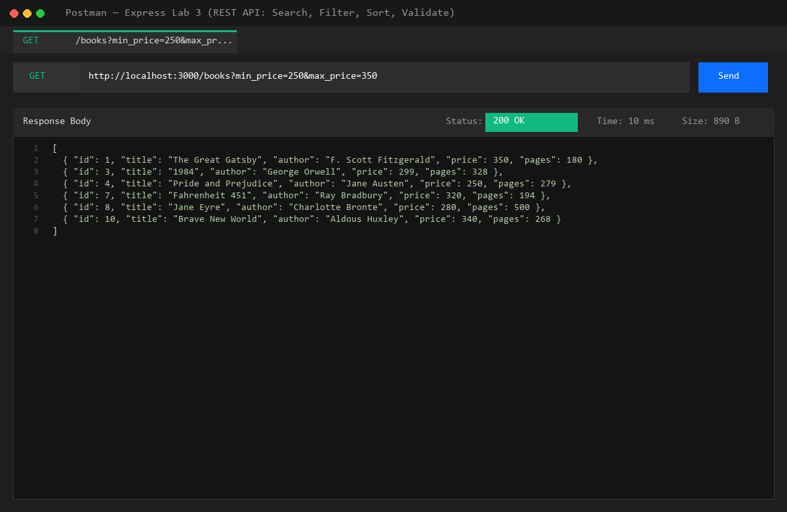

#### 5. Pagination with Limit and Offset (`GET /books?limit=2&offset=2`)
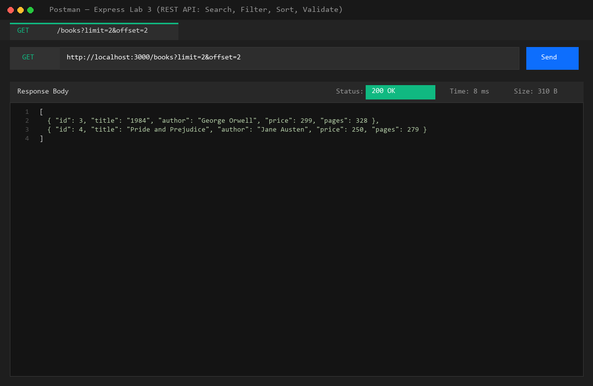

#### 6. GET Single Book by ID (`GET /books/1`)
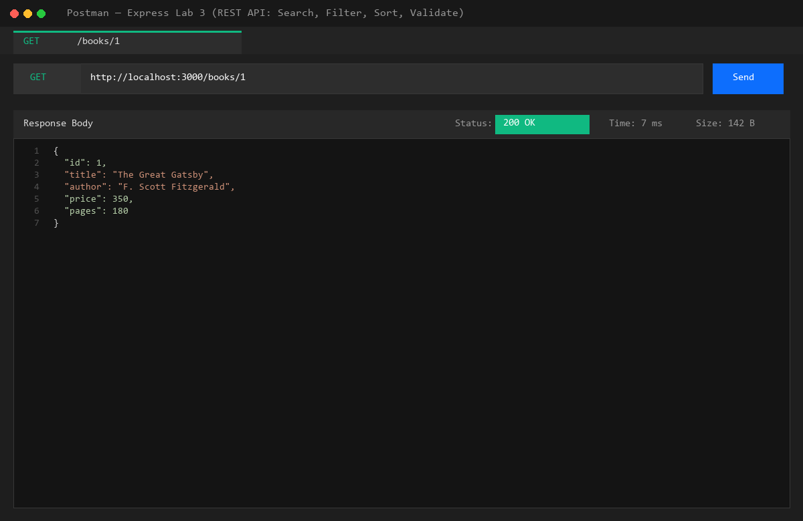

#### 7. Validation Error: Missing Title (`POST /books` -> 400 Bad Request)


#### 8. Validation Error: Non-Numeric Price (`POST /books` -> 400 Bad Request)
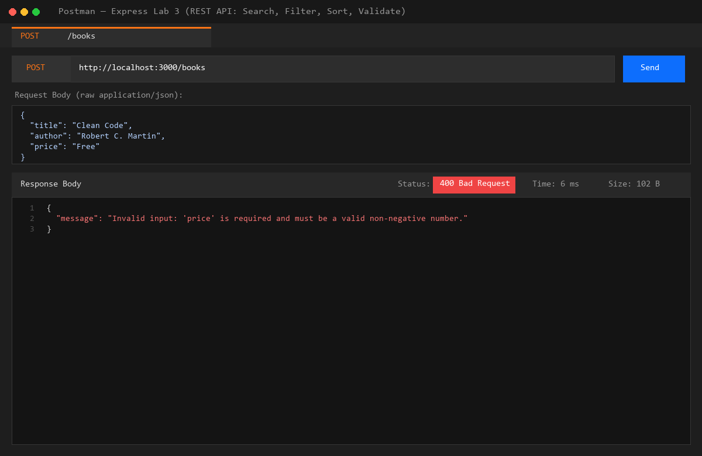

#### 9. Create Book Success (`POST /books` -> 201 Created)
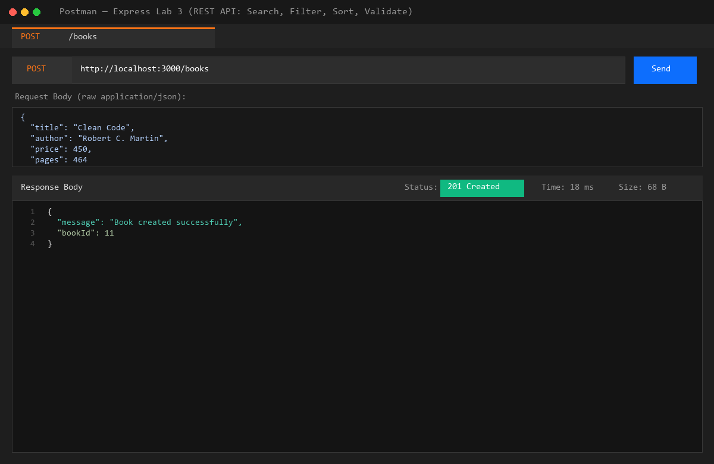

#### 10. Update Book Success (`PUT /books/11` -> 200 OK)
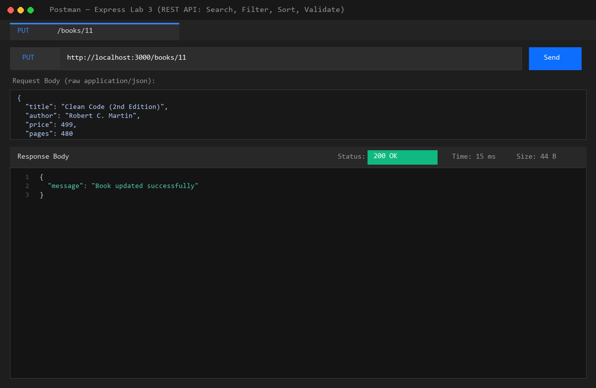

#### 11. Update Non-Existent Book (`PUT /books/99999` -> 404 Not Found)
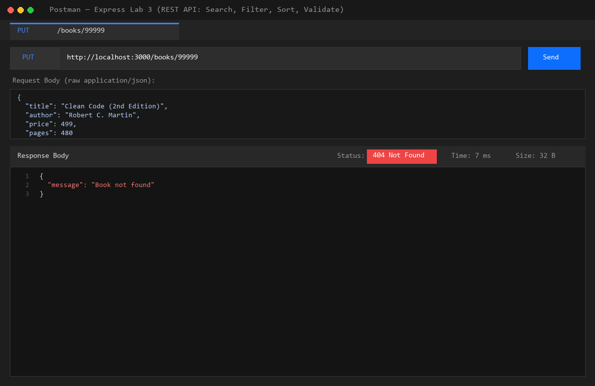

#### 12. Delete Book Success (`DELETE /books/11` -> 200 OK)
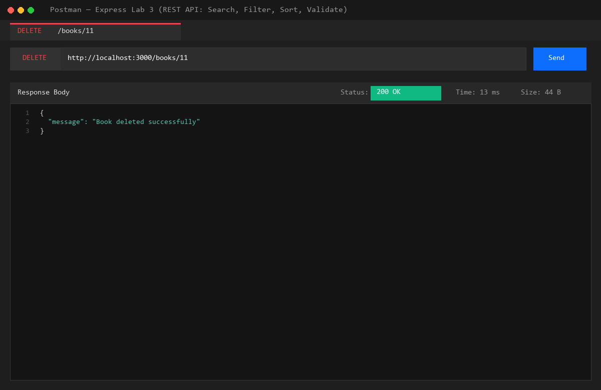

#### 13. Verify Deletion (`GET /books/11` -> 404 Not Found)
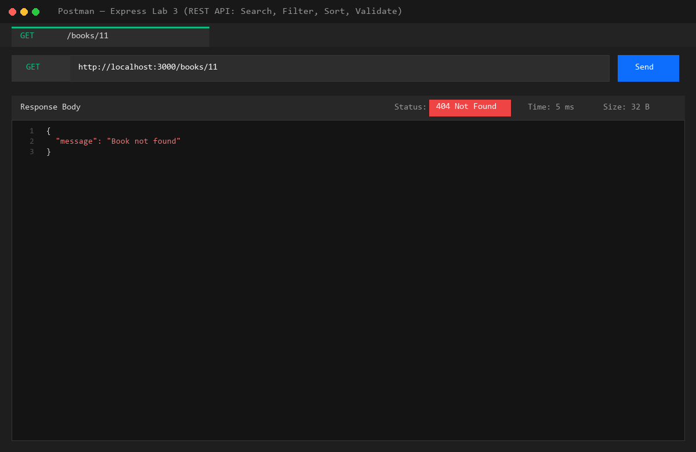

#### 14. Faculty Debugging Exercise: 4 Bug Fixes Verified in Terminal
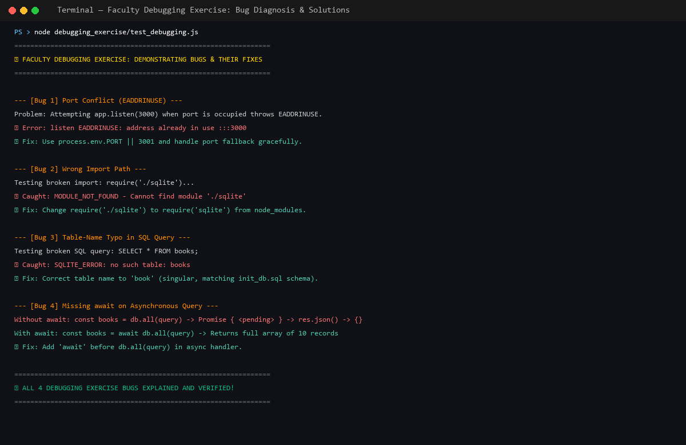

---

### Notes: Problems Faced and How You Solved Them

1. **Port Conflict (`EADDRINUSE`):**
   - *Problem:* A hardcoded port (`const PORT = 3000;`) crashes the server if port 3000 is occupied by a background process or previous test instance.
   - *Solution:* Used dynamic environment variable fallback `const PORT = process.env.PORT || 3001;` and attached an `error` listener to the HTTP server instance to automatically fall back to an open OS-assigned ephemeral port (`server.listen(0)`).

2. **Wrong Module Import Path (`MODULE_NOT_FOUND`):**
   - *Problem:* Faculty code had `require('./sqlite')` with a relative dot-slash prefix, causing Node.js to search for a local file instead of the package in `node_modules`.
   - *Solution:* Changed the statement to `const { open } = require('sqlite');` so Node's CommonJS module resolver loads the installed package.

3. **Table-Name Typo in SQL (`SQLITE_ERROR: no such table: books`):**
   - *Problem:* The table was declared in singular form `book` inside `init_db.sql`, but the query requested `SELECT * FROM books;` (plural).
   - *Solution:* Updated SQL queries across all route handlers to query `book` (singular).

4. **Missing `await` on Asynchronous Queries:**
   - *Problem:* Omitting `await` before `db.all(query)` assigns an unresolved `Promise { <pending> }` to the variable. Express `res.json()` serializes promises to empty JSON objects `{}` with status 200, returning no data to the client.
   - *Solution:* Added `await` before all SQLite async calls (`await db.all(...)`, `await db.get(...)`, `await db.run(...)`).

5. **SQL Injection Prevention in `ORDER BY` and `order`:**
   - *Problem:* SQLite prepared statement placeholders (`?`) only work for data literals, not for SQL keywords or column names in `ORDER BY`. Direct string interpolation (`ORDER BY ${order_by}`) creates SQL injection risks.
   - *Solution:* Implemented whitelist validation: checked `order_by` against `['id', 'title', 'author', 'price', 'pages']` and `order` against `['ASC', 'DESC']`. Any invalid input safely falls back to `id ASC`.

6. **Consistent Error Envelope (`{ "message": "..." }`):**
   - *Problem:* Mixed return formats across routes (e.g., plain text strings for updates/deletions vs JSON objects for errors) create unpredictable API response contracts.
   - *Solution:* Standardized all status and error messages to `{ "message": "..." }`, while returning raw arrays/objects for successful GET queries.

---

### Viva Questions & Answers

#### 1. Query parameter vs path parameter?
- **Path Parameters (`/books/:bookId`):**
  - Used to identify a **specific resource** or entity in the database hierarchy.
  - Essential part of the resource URL path (e.g., `/books/2` refers directly to the book record with primary key 2).
- **Query Parameters (`/books?search_q=Gatsby&limit=5`):**
  - Used to **filter, sort, search, or paginate** a collection of resources.
  - Optional key-value pairs appended after `?` separated by `&`. They do not change which resource type is targeted, but modify how the data representation is returned.

#### 2. What does stateless mean?
- **Statelessness** is a core architectural constraint of REST.
- It means that **every HTTP request from client to server must contain all of the information needed to understand and process the request**.
- The server does not store any client session context between requests.
- Benefits:
  - High scalability: any available server instance can process any incoming request.
  - Reliability: server restarts do not lose user session state.
  - Simplicity: client and server lifecycles are decoupled.

#### 3. Which status code for bad input vs a missing record?
- **`400 Bad Request` for Bad Input:**
  - Used when the client submits invalid, malformed, or missing data in the request body, headers, or query parameters (e.g., missing `title`, missing `author`, or passing `'Free'` for a numeric `price`).
- **`404 Not Found` for Missing Record:**
  - Used when the request syntax is valid, but the target resource identifier does not match any existing record in the database (e.g., `GET /books/99999` or updating/deleting an ID that does not exist).
